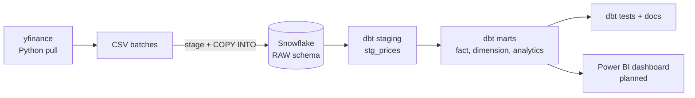

# Equities Analytics Pipeline — Snowflake + dbt

An end-to-end analytics engineering project: two years of daily equity prices loaded raw into **Snowflake**, transformed with **dbt** into tested, documented, analytics-ready tables, including an **incremental** fact table that processes only new data.

## Problem

Raw market data is not analysis-ready: it needs cleaning, a consistent grain, reference data (company and sector), and derived metrics such as returns and moving averages. This project builds that transformation layer the way a production analytics team would, with layered models, automated data tests, generated lineage, and incremental loading, so every downstream number is reproducible and traceable to its source.

## Architecture

## Lineage

Generated by dbt from `source()` and `ref()`, not drawn by hand:

## Data

- **15 securities** across 5 groups: Technology (AAPL, MSFT, NVDA, GOOGL), Financials (JPM, GS, BAC), Energy (XOM, CVX), Healthcare (JNJ, UNH, PFE), Consumer (AMZN, WMT), plus **SPY** as a market benchmark.
- **7,560 rows** of daily OHLCV prices, 2024-09-03 → 2026-09-04, pulled with [`pull_prices.py`](pull_prices.py) using `yfinance`.
- Split into two batches to simulate new data arriving: **batch 1** (5,670 rows, through 2026-03-06) for the initial build, **batch 2** (1,890 rows, from 2026-03-09) for the incremental load.

## Stack

| Layer | Tool |
|---|---|
| Ingestion | Python (`yfinance`) → CSV → Snowflake stage + `COPY INTO` |
| Warehouse | Snowflake (X-Small warehouse, 60-second auto-suspend) |
| Transformation | dbt (Studio IDE), connected via key-pair authentication |
| Version control | GitHub, feature branches merged via pull requests |
| BI | Power BI (planned) |

## dbt models

| Model | Layer | Materialization | Purpose |
|---|---|---|---|
| `stg_prices` | Staging | View | Cleans raw prices: renames columns, standardizes types. One-to-one with the source. |
| `dim_securities` | Mart | Table | Ticker → company name, sector, benchmark flag. Built from the `securities` seed. |
| `fct_daily_prices` | Mart | **Incremental** | Daily price fact table. Grain: one row per ticker per trading day. |
| `mart_daily_returns` | Mart | Table | Daily return per ticker from adjusted close. |
| `mart_moving_averages` | Mart | Table | 50- and 200-trading-day moving averages. |
| `mart_sector_performance` | Mart | Table | Equal-weighted daily and cumulative sector returns, including SPY as benchmark. |

Staging models are views (cheap, always current); marts are tables (precomputed for fast BI queries). Defaults are set per layer in `dbt_project.yml`.

## Data quality

10 dbt tests run on every build (`dbt build`):

| Test | Applied to | What it guarantees |
|---|---|---|
| `unique` + `not_null` | `fct_daily_prices.price_key` | The grain holds: exactly one row per ticker per day |
| `relationships` | `fct_daily_prices.ticker` → `dim_securities.ticker` | Every price has a matching security (Snowflake does not enforce foreign keys) |
| `unique` + `not_null` | `dim_securities.ticker` | No duplicate or missing securities |
| `accepted_values` | `dim_securities.sector` | Sector labels are limited to the defined set |
| `not_null` | key fact columns | No missing dates, tickers, or prices |

Outputs were also reconciled against independent calculations during development: row counts match raw at every layer, a moving average matches a manual calculation, and SPY's compounded daily returns match its actual start-to-end price change.

## Incremental model

`fct_daily_prices` is an incremental model. After the first build it processes only rows newer than the latest date already loaded, and merges on `price_key` so a re-run never creates duplicates. Each row carries a `dbt_loaded_at` timestamp recording when it was processed.

**Proof.** Batch 1 was built, then batch 2 was loaded into raw and dbt ran normally:

| Load | Rows processed | Price dates |
|---|---|---|
| Initial build | 5,670 | 2024-09-03 → 2026-03-06 |
| Incremental run | 1,890 | 2026-03-09 → 2026-09-04 |

The original 5,670 rows kept their first load timestamp; only the 1,890 new rows were processed. Total rows and distinct keys both equal 7,560.

| Before | After |
|---|---|
|  |  |

## Design decisions

- **Adjusted close, not close.** Adjusted close accounts for splits and dividends (e.g., NVIDIA's 10-for-1 split in 2024), so returns and moving averages are continuous.
- **Returns calculated in marts, not the incremental fact table.** Returns and moving averages need prior days' prices, which an incremental run filtering on new dates would not see. Marts rebuild from the full fact table.
- **Moving averages are null until the window is full.** A "50-day" average on day 10 would really be a 10-day average, so partial windows are left empty rather than shown as misleading values.
- **Equal-weighted sectors.** No market-cap data was available, so each stock counts equally within its sector.
- **Simplified sector labels.** GOOGL is grouped as Technology and AMZN/WMT as Consumer; GICS would classify these as Communication Services, Consumer Discretionary, and Consumer Staples.
- **Key-pair authentication** for dbt → Snowflake, since password authentication is deprecated for service connections.

## How to run

1. **Pull data:** `python pull_prices.py` (writes the CSV batches).
2. **Set up Snowflake:** create a database (`EQUITIES`), a `RAW` schema, an X-Small warehouse, and the `RAW_DAILY_PRICES` table; upload the batch 1 CSV to a stage and load it with `COPY INTO`.
3. **Connect dbt** to Snowflake (key-pair authentication) and to this repository.
4. **Build:** `dbt build` (loads the seed, builds all models in dependency order, and runs all tests).
5. **Incremental demo:** load the batch 2 CSV into the same raw table, then run `dbt run --select fct_daily_prices`.

## Status

- [x] Raw data loaded into Snowflake
- [x] Staging and mart models
- [x] Data tests passing
- [x] Incremental fact table, with evidence
- [x] Lineage documentation
- [ ] Power BI dashboard

## Next steps / parked

Deliberately left out to keep the scope focused:

- Power BI dashboard on the mart tables (in progress)
- Model and column descriptions for richer dbt docs
- dbt snapshots for slowly changing dimensions
- Scheduled dbt job and a production environment
- A dedicated least-privilege Snowflake role for dbt
- Lookback window on the incremental model to capture late price corrections
- Market-cap weighting and official GICS sectors
- A live or scheduled data feed in place of simulated batches