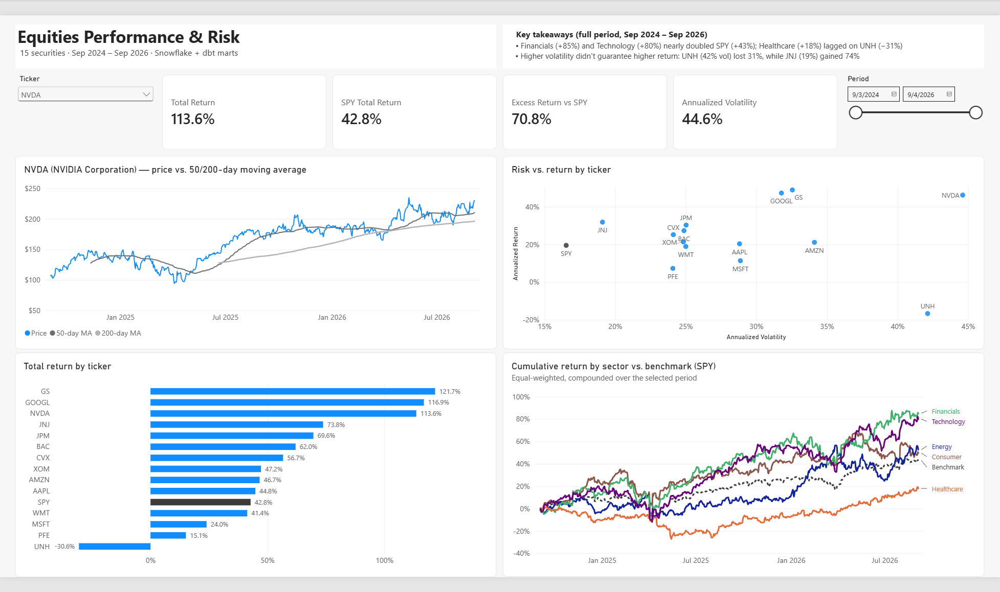
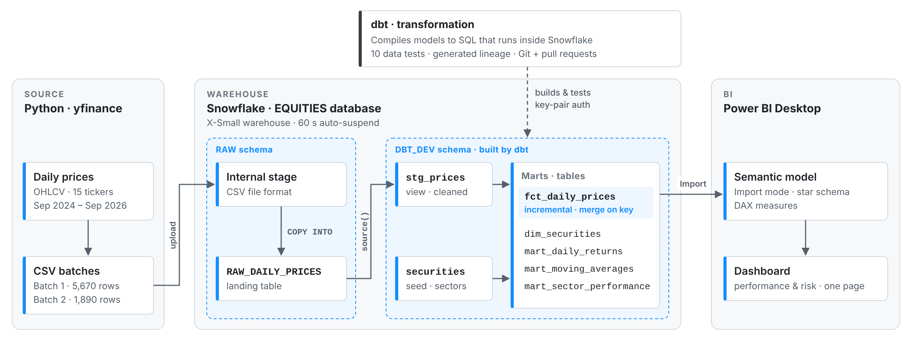
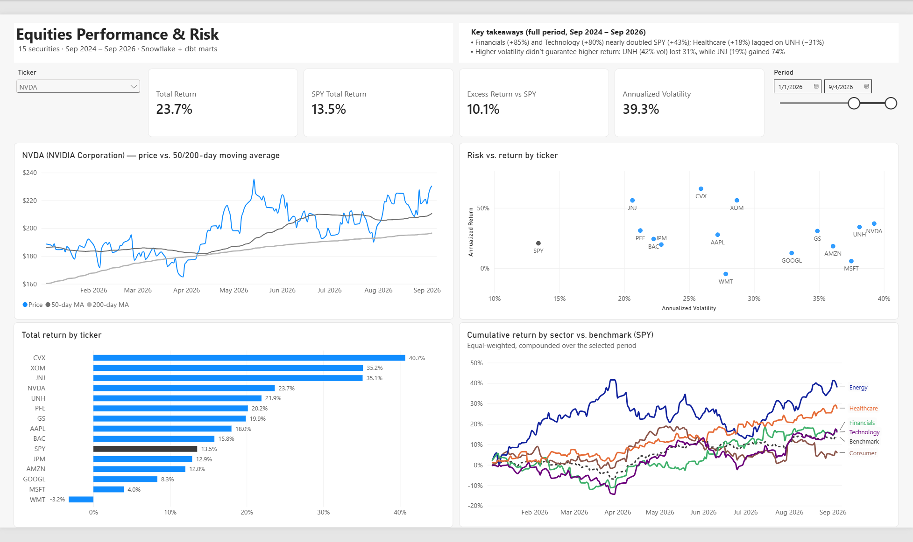
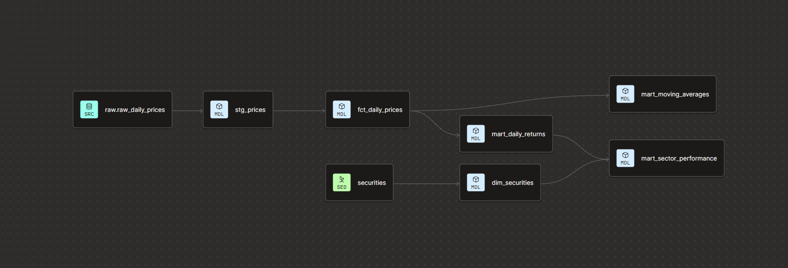
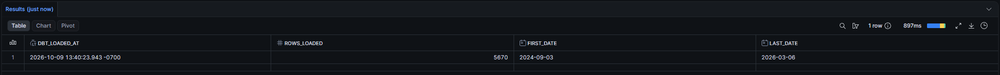
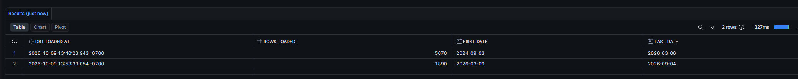

# Equities Analytics Pipeline · Snowflake, dbt, Power BI

An ELT pipeline that lands two years of daily equity prices in **Snowflake**, models them with **dbt** into tested, documented marts, including an **incremental** fact table, and serves a **Power BI** performance-and-risk dashboard. Every number is reproducible and traceable to its source.

## Highlights

- **Incremental loading, verified.** On the second load, `fct_daily_prices` processed only the 1,890 new rows and left the existing 5,670 untouched. It merges on a unique key, so re-runs never create duplicates.
- **Tested on every build.** 10 dbt tests enforce the fact table's grain and its referential integrity to `dim_securities`, which Snowflake lets you declare but does not enforce.
- **Reconciled across tools.** SPY's 42.8% return agrees between the dbt sector mart (SQL) and the Power BI measure (DAX), and row counts reconcile from raw through every layer.
- **Finance-aware metrics.** Returns come from dividend-adjusted prices, moving averages stay empty until their window is full, and risk vs. return is compared on an annualized basis.
- **Cost-conscious.** An X-Small warehouse with 60-second auto-suspend, plus Power BI in Import mode; the full build used about $2 of Snowflake credit.

## Architecture

## Dashboard

A one-page Power BI report built on the dbt marts.

- **Import mode, not DirectQuery.** The marts are small and refreshed in batches; DirectQuery would bill Snowflake compute on every click.
- **Star schema.** `dim_securities` filters every fact table, so one ticker slicer drives all related visuals.
- **Guarded measures.** Return and volatility measures return blank unless exactly one ticker is in context, so no visual can show a meaningless total.
- **Returns follow the selected period.** Total return compounds daily returns over the date-slicer window in DAX, and the sector chart restarts at 0% at the start of the window. Moving averages do not restart: each one belongs to its date and always uses the prior 50 or 200 trading days.
- **Like-for-like risk vs. return.** The scatter plots annualized return against annualized volatility.

*The same page with the period set to Jan 1 – Sep 4, 2026: every sector line restarts at 0%, and the benchmark line ends at the SPY card's value (13.5%).*

## Lineage

Generated by dbt from the `source()` and `ref()` dependencies in the code:

## Data

- **15 securities** across 5 groups: Technology (AAPL, MSFT, NVDA, GOOGL), Financials (JPM, GS, BAC), Energy (XOM, CVX), Healthcare (JNJ, UNH, PFE), Consumer (AMZN, WMT), plus **SPY** as the market benchmark.
- **7,560 rows** of daily OHLCV prices, 2024-09-03 → 2026-09-04, pulled with [`pull_prices.py`](pull_prices.py) using `yfinance`.
- Loaded in two batches to exercise incremental processing: **batch 1** (5,670 rows, through 2026-03-06) for the initial build, and **batch 2** (1,890 rows, from 2026-03-09) for the incremental run.

## Stack

| Layer | Tool |
|---|---|
| Ingestion | Python (`yfinance`) → CSV → Snowflake stage + `COPY INTO` |
| Warehouse | Snowflake (X-Small warehouse, 60-second auto-suspend) |
| Transformation | dbt (Studio IDE), connected via key-pair authentication |
| Version control | GitHub, feature branches merged via pull requests |
| BI | Power BI Desktop (Import mode, DAX measures) |

## dbt models

| Model | Layer | Materialization | Purpose |
|---|---|---|---|
| `stg_prices` | Staging | View | Cleans raw prices: renames columns, standardizes types. One-to-one with the source. |
| `dim_securities` | Mart | Table | Ticker → company name, sector, benchmark flag. Built from the `securities` seed. |
| `fct_daily_prices` | Mart | **Incremental** | Daily price fact table. Grain: one row per ticker per trading day. |
| `mart_daily_returns` | Mart | Table | Daily return per ticker from adjusted close. |
| `mart_moving_averages` | Mart | Table | 50- and 200-trading-day moving averages. |
| `mart_sector_performance` | Mart | Table | Equal-weighted daily and cumulative sector returns, including SPY as benchmark. |

Staging models are views, so they cost nothing to store and always reflect raw data. Marts are tables, so BI queries read precomputed results. Defaults are set per layer in `dbt_project.yml`.

## Data quality

10 dbt tests run on every build (`dbt build`):

| Test | Applied to | What it guarantees |
|---|---|---|
| `unique` + `not_null` | `fct_daily_prices.price_key` | The grain holds: exactly one row per ticker per day |
| `relationships` | `fct_daily_prices.ticker` → `dim_securities.ticker` | Every price has a matching security (Snowflake does not enforce foreign keys) |
| `unique` + `not_null` | `dim_securities.ticker` | No duplicate or missing securities |
| `accepted_values` | `dim_securities.sector` | Sector labels are limited to the defined set |
| `not_null` | key fact columns | No missing dates, tickers, or prices |

Outputs were also reconciled against independent calculations: row counts match raw at every layer, a moving average matches a manual calculation, and SPY's compounded daily returns match its start-to-end price change.

## Incremental model

`fct_daily_prices` is an incremental model. After the first build it processes only rows newer than the latest date already loaded, and merges on `price_key` so a re-run never creates duplicates. Each row carries a `dbt_loaded_at` timestamp recording when it was processed.

**Verification.** After the initial build, batch 2 was loaded into raw and dbt ran normally:

| Load | Rows processed | Price dates |
|---|---|---|
| Initial build | 5,670 | 2024-09-03 → 2026-03-06 |
| Incremental run | 1,890 | 2026-03-09 → 2026-09-04 |

The original 5,670 rows kept their first load timestamp; only the 1,890 new rows were processed. Total rows and distinct keys both equal 7,560.

| Before | After |
|---|---|
|  |  |

## Design decisions and trade-offs

- **Adjusted close, not close.** Yahoo's close is split-adjusted but excludes dividends; adjusted close includes them, so every return here is a total return. It matters for dividend payers: over the first 18 months of data, Pfizer's price return was −4.4%, but its total return was +5.8%.
- **Returns calculated in marts, not the incremental fact table.** Returns and moving averages need prior days' prices, which an incremental run filtering on new dates would not see. Marts rebuild from the full fact table.
- **Moving averages are empty until the window is full.** A "50-day" average on day 10 would really be a 10-day average, so partial windows are left empty rather than shown as misleading values.
- **Equal-weighted sectors.** No market-cap data was available, so each stock counts equally within its sector.
- **Small, hand-picked basket.** Each sector line reflects 2–4 large-cap names chosen in advance; the lines are illustrative, not representative sector indexes.
- **Simplified sector labels.** GOOGL is grouped as Technology and AMZN/WMT as Consumer; GICS would classify these as Communication Services, Consumer Discretionary, and Consumer Staples.
- **Key-pair authentication** for dbt → Snowflake, since password authentication is deprecated for service connections.

## Known limitations

- **Batch replay, not a live feed.** The data comes from a one-time `yfinance` pull loaded in two batches; scheduling and orchestration are out of scope.
- **Development schema.** dbt builds into a personal development schema (`DBT_DEV`), and Power BI reads from it. A production setup would use a separate schema built by a scheduled job.
- **Adjusted-close restatement.** Adjusted prices are restated backward whenever a dividend is paid, but the incremental model only appends new dates, so older adjusted prices can drift until a full refresh.

## Roadmap

- Lookback window and periodic full refresh, to capture late corrections and dividend restatements
- Scheduled dbt job with a production environment and a least-privilege Snowflake role
- Model and column descriptions for richer dbt docs; dbt snapshots for slowly changing dimensions
- Market-cap weighting and official GICS sectors
- A live or scheduled data feed in place of batch replay
- Power BI report saved as a `.pbip` project for version control, with takeaways driven by DAX measures

## How to reproduce

1. **Pull data:** `python pull_prices.py` (writes the CSV batches).
2. **Set up Snowflake:** create a database (`EQUITIES`), a `RAW` schema, an X-Small warehouse, and the `RAW_DAILY_PRICES` table; upload the batch 1 CSV to a stage and load it with `COPY INTO`.
3. **Connect dbt** to Snowflake (key-pair authentication) and to this repository.
4. **Build:** `dbt build` loads the seed, builds all models in dependency order, and runs all tests.
5. **Incremental load:** load the batch 2 CSV into the same raw table, then run `dbt run --select fct_daily_prices`.
6. **Dashboard:** in Power BI Desktop, connect to Snowflake in Import mode and load `DIM_SECURITIES` and the three `MART_*` tables.
